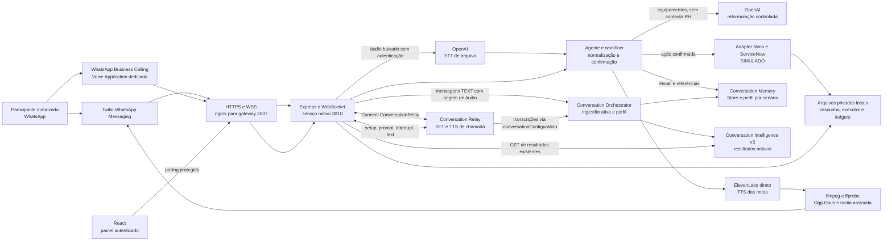

# Arquitetura implementada

## Escopo

A Glô demonstra continuidade de contexto de um único participante autorizado, representando Gustavo com dados fictícios. A jornada combina férias com datas indefinidas e solicitação de microfones/kits. A conta, sender e backend são reais; políticas, personagem, pedidos e executor de equipamentos são demonstrativos. Não há autenticação corporativa, aprovação real de férias, estoque, despacho ou SLA.

## Responsabilidades e código

| Área | Arquivos principais |
| --- | --- |
| Gateway e compatibilidade anterior | `server/coexist.ts`, `server/native-router.ts` |
| Bootstrap e seleção de recursos | `native/server/index.ts`, `config.ts`, `scripts/scenario.mjs` |
| Webhooks, TwiML e painel | `native/server/app.ts` |
| Protocolo Relay e controle da sessão | `native/server/relay.ts`, `glo-session.ts`, `speech.ts` |
| Notas de voz e proveniência | `native/server/file-audio.ts`, `media.ts`, `audio-ingestion.ts` |
| Resposta e TTS | `native/server/voice-reply.ts`, `tts.ts`, `outgoing-media.ts` |
| Intenção, entidades e ferramentas | `native/server/ops-normalize.ts`, `operations.ts`, `execution.ts` |
| Memory nativo | `native/server/vacation.ts`, `operational-memory.ts` |
| Intelligence e validação | `native/server/native-analysis.ts`, `analysis.ts`, `call-analysis-discovery.ts` |
| Apresentação e detalhe técnico | `native/src/Presentation.tsx`, `App.tsx` |

## WhatsApp Messaging e notas de voz

O webhook valida assinatura Twilio e Account SID. `FileVoiceNotes` aceita somente o par From/To autorizado, registra o Message SID e deduplica **antes** de download/STT. Uma fila serial processa notas e texto; não existe fan-out multiusuário.

O downloader limita host, recurso, MIME e tamanho. Redirecionamento para o CDN Twilio não recebe as credenciais do primeiro request. STT de arquivo envia somente áudio fictício aprovado à OpenAI. O texto é ingerido no Orchestrator como Communication `TEXT`, mantendo referências do Message/Media e a origem STT. Isso não é uma transcrição de áudio Twilio Batch nem um segundo participante artificial.

Após normalização e consulta de contexto, o workflow executa ou prepara a ação. A resposta operacional pode ser reformulada pelo adapter OpenAI, com proteção contra local/quantidade inventados, promessa não suportada ou confirmação omitida. Coleta de campos faltantes e RH podem responder determinísticamente; não há LLM em todo turno.

TTS das notas usa a API ElevenLabs direta, separada do Relay. O modelo configurado é verificado por GET, incluindo suporte a português. O ramo aprovado do demonstrador usa `eleven_v4`, sem tags expressivas; o ramo desse modelo envia stability/similarity, omitindo speed/style. O exemplo de ambiente não substitui os overrides aprovados. Disponibilidade comercial do modelo e da voz deve ser revalidada na conta autorizada antes de uso futuro.

ffmpeg converte a saída para Ogg/Opus mono. A Twilio obtém o arquivo em URL temporária assinada. O envio não inclui caption na mídia; quando há protocolo, pode haver texto separado. O ledger registra síntese, envio, status, texto falado e ingestão da saída nativa. A entrega pela API não comprova reprodução: o participante deve confirmar que ouviu. Falha de TTS/codec usa fallback textual identificado; envio de resultado incerto não é repetido automaticamente.

## Calling e Conversation Relay

A Voice Application do sender autorizado chama `/globo/native/voice`. O backend admite a identidade de teste, emite um nonce vinculado ao Call SID e retorna `Connect > ConversationRelay`, com URL WSS, idioma, voz e `conversationConfiguration`.

O handshake WSS valida assinatura e os vínculos de conta/Call SID/nonce. A sessão trata `setup`, `prompt`, `interrupt`, erros e encerramento; prompts parciais são agregados conforme o protocolo. O streaming/chunking existe no transporte; o composer de equipamentos da sessão Gustavo pode aguardar a resposta completa antes de emitir fala. Não afirmar latência de token-a-token do modelo para todos os turnos.

A síntese de chamadas pertence ao Relay, com ElevenLabs configurado no TwiML. A chave ElevenLabs direta das notas não é enviada ao frontend nem reutilizada como credencial da Twilio. Confirmação é normalizada, mas só altera pedido com ação pendente válida e retorno positivo do executor.

## Memory e fontes de verdade

| Informação | Fonte usada |
| --- | --- |
| Identidade fictícia do participante | Perfil e identificadores phone/whatsapp no Store do cenário |
| Férias | Trait contendo **ponteiro de origem**, depois Recall nativo da Communication correspondente |
| Referências de pedidos | Trait `GloboOperations.referencesJson` no perfil nativo |
| Quantidade, local, status, versão do pedido | Executor local simulado, consultado por identidade e ID |
| Rascunho e confirmação pendente | `workflow-draft.json`, persistência local **não nativa** |
| Resultados Intelligence | API nativa, com esquema e citações verificadas contra Communications |

O mês de férias não é pré-carregado nem gravado como fato em um trait pelo agente. O código grava IDs da origem e busca a comunicação por Recall, validando ID, canal e autor/perfil. Sem origem retornada, limpa o contexto e pede esclarecimento. O roteiro suporta mês e datas indefinidas, não aprova férias.

Para equipamentos, Memory fornece referências; uma observação antiga não sobrescreve o estado atual do adapter. Recuperar contexto entre sessões é diferente de manter o rascunho local entre turnos. A demonstração usa ambos e os distingue.

## Orchestrator

Cada cenário Gustavo tem Store, perfil e configuração próprios, `GROUP_BY_PROFILE`, Voice/WhatsApp e extração habilitada. Usa ingestão ativa por API/TwiML; não depende de capture rules passivas. O Intelligence v3 dedicado existente pode ser reutilizado por vários cenários sem alterar operadores.

Uma chamada pode ocupar mais de uma Conversation por causa dos timeouts de ciclo de vida. A descoberta correlaciona todas as Communications com o Call SID e confere conta/configuração. Uma sessão do agente, Relay Session, Call SID, Message SID e Conversation ID são identificadores diferentes.

## Intelligence v3 e painel

Há cinco operadores: impacto operacional, urgência/reincidência, resolução efetiva, governança e atrito operacional. O template da configuração demonstrativa tem impacto **on-demand** e quatro operadores acionados no encerramento da Conversation. Definições dos operadores não são uma comprovação de execução.

O coletor faz GET de conversas, Communications e Operator Results. Resultado deve pertencer à conta, configuração e operador autorizados, respeitar o esquema e conter citações existentes na fonte. Citação inexistente separa apenas aquele resultado; não cria substituto nem corrige o texto original. Erros de escopo continuam bloqueando a leitura.

O frontend faz polling aproximadamente a cada 1,5 s. O GET de analytics atualiza resultados nativos existentes com throttle de 30 s. O botão de consulta também lê resultados existentes; **não chama RuleExecutions**. Há código de callback on-demand no bootstrap, mas ele não é invocado por essas rotas de consulta atuais. O endpoint de notificação assinado existe; configuração do webhook remoto não é presumida.

Os cartões operacionais selecionam a Conversation da primeira nota de equipamentos. As evidências técnicas mostram outros resultados válidos. Resultado de férias que menciona antecedência fictícia não deve ser usado como urgência de produção. A agregação de categorias é da aplicação, não outro operador Twilio.

## Estado, versão e idempotência

Campos definidos são mesclados no rascunho; dados ausentes não apagam os anteriores. “Microfone” não é convertido implicitamente em “kit completo”. O agente pergunta somente pelos campos faltantes. Local e quantidade ainda respeitam as restrições do executor demonstrativo.

Criar/atualizar exige confirmação. O adapter usa chave de idempotência e controle de versão; histórico de alteração mantém o mesmo protocolo. Replay do mesmo Message SID não repete STT/envio. Repetição de confirmação após conclusão não incrementa versão. Isso não é transação distribuída: falha entre executor, gravação de arquivo e Memory exige reconciliação, não promessa de exactly-once em produção.

## Limites de produção

Instância single-process, identidade técnica única, filas/estado compartilhados por cenário e armazenamento em arquivos. Não há SSO, autorização corporativa, multi-tenant seguro, orçamento global, rate limiting por usuário, retenção completa de transcripts, HA ou contrato real de executor. QR Code público é NO-GO sem novo desenho. As políticas são fictícias; não usar estas regras como política da Globo.

Referências de produto: [protocolo Relay](https://www.twilio.com/docs/voice/conversationrelay/websocket-messages), [ingestão Orchestrator](https://www.twilio.com/docs/conversations/orchestrator/concepts/ingestion), [Memory](https://www.twilio.com/docs/conversations/memory), [Operator Results v3](https://www.twilio.com/docs/api/intelligence/v3/operator-results), [síntese ElevenLabs](https://elevenlabs.io/docs/api-reference/text-to-speech/convert). Essas referências descrevem produtos; as capacidades deste projeto são as verificadas no código acima.
